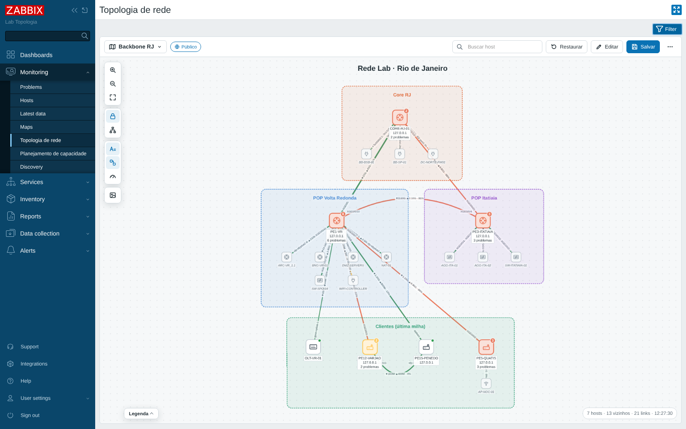
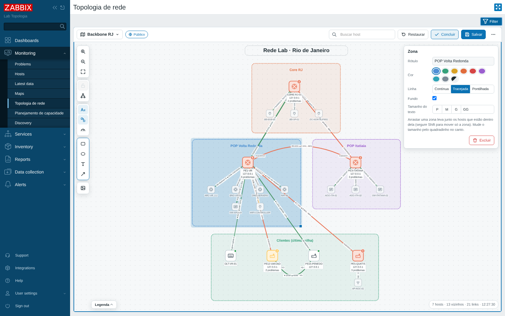
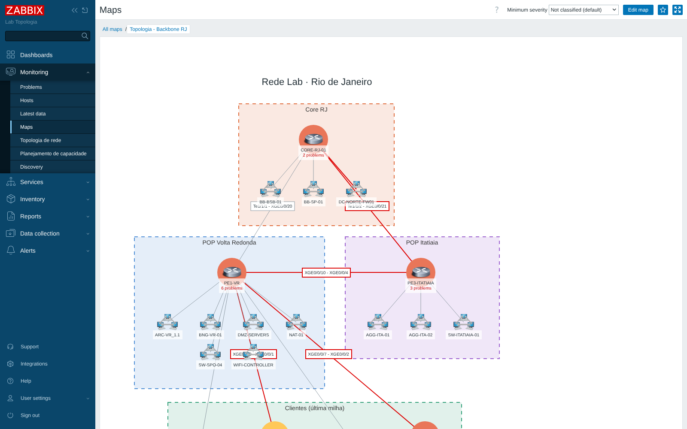
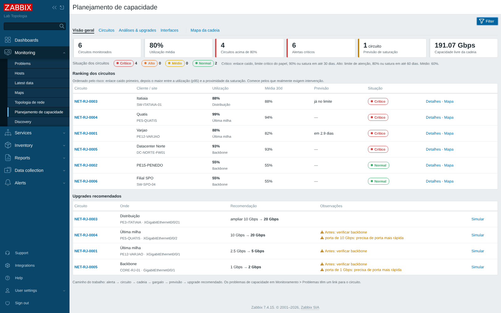
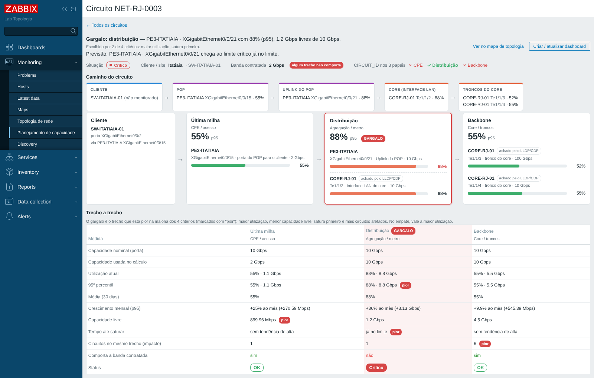
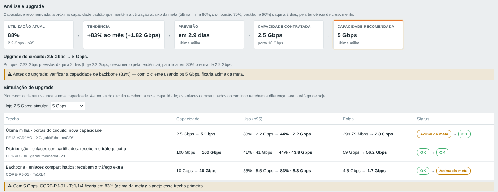
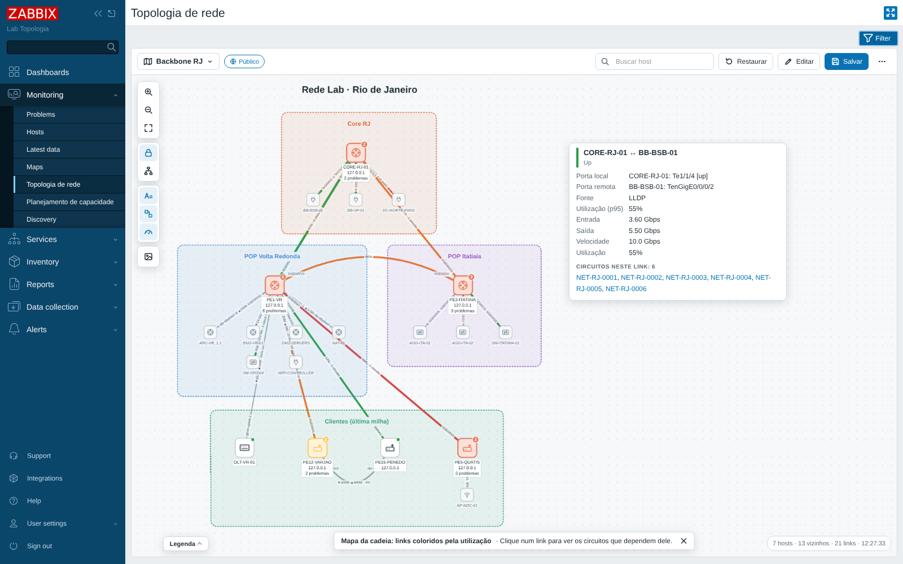
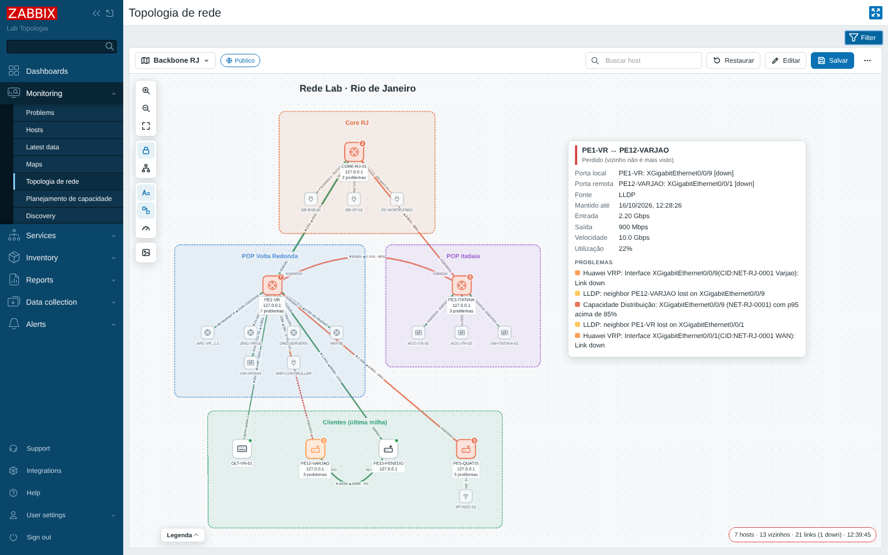
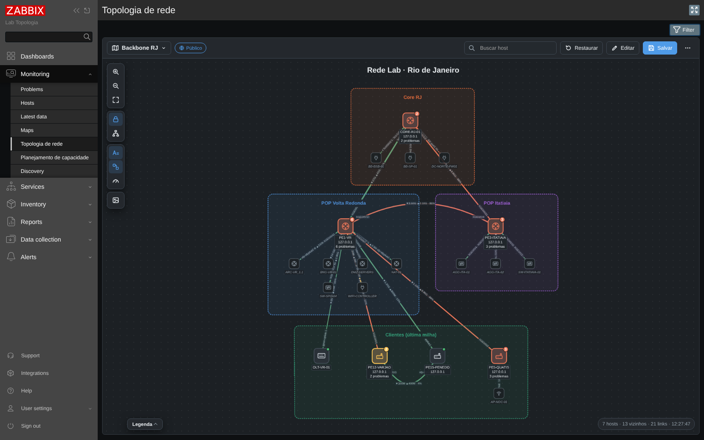

# Network Topology — módulo de topologia de rede para Zabbix 7.x

[English](README.md) · **Português**

Módulo de frontend que adiciona ao Zabbix:

- **Monitoramento → Topologia de rede**: um mapa da rede montado a partir dos vizinhos **LLDP/CDP** dos equipamentos, com os hosts coloridos pela severidade dos problemas e os links pelo estado das portas. Os mapas podem ser **salvos com nome**, com posições fixas, links curvos e desenhos (zonas, textos, linhas) — os mapas **públicos** viram o padrão de todas as equipes — e **publicados como mapa nativo do Zabbix**, para usar em dashboards;
- **Monitoramento → Planejamento de capacidade**: capacity planning **por circuito** (CIRCUIT_ID), com a carga de cada trecho (backbone, distribuição, última milha), o **gargalo** escolhido por 4 critérios, a folga, a banda contratada, a previsão de saturação, a **capacidade recomendada** com **simulação de upgrade** e o **mapa da cadeia** (links coloridos pela utilização). Detalhes em [docs/capacity-planning.md](docs/capacity-planning.md).

Testado no **Zabbix 7.4.15** e **7.0.31** (frontend e server reais, equipamentos simulados por SNMP com os templates oficiais Huawei VRP, Cisco IOS e Mikrotik).



## O que ele faz

- **Nós = hosts do Zabbix**: um "bloco" com o ícone do tipo de equipamento (roteador, switch, firewall, OLT, CPE, AP...). Sem problema, o bloco fica neutro com um ponto verde; com problema, a borda e o ícone ficam na cor da maior severidade ativa (cores de *Administração → Geral*) e um selo mostra quantos problemas há. Selos de manutenção e de host indisponível.
- **Vizinhos que não são hosts do Zabbix** aparecem menores, pontilhados e em itálico (dá pra esconder).
- **Links** com o nome da porta em cada ponta, abreviado como no equipamento (`XGE0/0/1`, `Gi0/1`, `Te1/1/1`; o nome completo aparece ao passar o mouse):
  - verde = up, vermelho grosso = down (ifOperStatus), vermelho pontilhado = **vizinho perdido** (sumiu do LLDP), laranja/amarelo = problema na porta (ex.: alto uso de banda), tracejado = até um vizinho que não é host;
  - tráfego ▼/▲ e % de utilização (quando os itens de interface existem) e espessura pela velocidade do link.
- **Fontes de links** (selecionáveis no filtro): LLDP, CDP, tags de host, links de mapas existentes do Zabbix e dependências de trigger.
- **Interação**: roda do mouse = zoom no ponto do cursor (cerca de 20% por clique da roda; no touchpad, suave); clique no host = menu nativo do Zabbix (Problemas, Últimos dados, Gráficos, scripts...); duplo clique = destaca a vizinhança; passar o mouse = detalhes; busca; organizar automaticamente (camadas com o core no topo, forças, círculo, grade); exportar PNG; modo quiosque; atualização automática sem mexer em nada.
- Interface em português ou inglês conforme o idioma do usuário.

## Mapas salvos: o padrão das equipes

Pense no mapa como uma planta da rede pendurada na parede da sala do NOC: todo mundo olha a mesma planta, qualquer um pode chegar perto e afastar um equipamento para enxergar melhor, mas só quem cuida da planta redesenha a oficial.



- **Seletor de mapa** (canto superior esquerdo do mapa): **Mapas públicos** (o padrão de todas as equipes), **Meus mapas** (só você vê) e **Seleção livre** (os hosts do filtro, sem mapa).
- **Um mapa guarda**: os hosts selecionados no filtro (grupos, hosts, mapas, fontes de link), a posição de cada nó, o formato de cada link e os desenhos.
- **Já vem arrumado e travado** 🔒: um mapa salvo abre exatamente como foi salvo, com as posições travadas. O cadeado da barra da esquerda destrava para mexer; **Restaurar** volta ao original. Mexer na tela não muda o mapa de ninguém.
- **Sem mapa salvo**, o arranjo automático é sempre o mesmo para os mesmos hosts (não "embaralha" a cada vez que abre): **camadas** — core no topo, distribuição no meio, CPEs embaixo — quando os hosts têm papel (templates de capacity planning ou tag `topology.level`), senão o arranjo por forças.
- **Editar** (botão no topo): arraste os hosts (eles encaixam numa grade), **arraste um link para curvá-lo** (dois cliques voltam ao automático; no painel da direita há também **cotovelo** e **reta**), desenhe **zonas** (retângulo ou elipse, com nome e cor — arrastar a zona leva junto os hosts que estão dentro), **textos** e **linhas/setas**. Delete apaga o desenho selecionado.
- **Salvar** grava o mapa aberto (se você pode alterá-lo); **Salvar cópia** / **Salvar como novo mapa** cria outro (pessoal ou, para editores, público). Se outra pessoa salvou o mesmo mapa enquanto você editava, o módulo avisa em vez de sobrescrever.
- **Mapa inicial**: um mapa público pode ser o que abre para quem ainda não escolheu nenhum (menu **⋯**).
- **Publicar como mapa nativo do Zabbix** (menu **⋯**): cria ou atualiza um mapa em *Monitoramento → Mapas* com os hosts nas mesmas posições, as zonas, os textos e as linhas. Cada link recebe os triggers das suas portas (fica vermelho quando a porta cai) — é o jeito de "fixar" o mapa num **dashboard** (widget Mapa) e de usar as permissões de mapa do Zabbix. Os mapas nativos só desenham links retos.
- **Copiar link do mapa**: um endereço que abre direto aquele mapa (bom para favoritos e para o modo quiosque).



### Quem pode alterar os mapas públicos

Por padrão, usuários do tipo **Admin** e **Super admin**. Todo mundo abre os mapas públicos, mexe na própria tela e salva mapas pessoais.

Um Super admin muda isso em **⋯ → Configurações** (ou `zabbix.php?action=nettopo.settings`): "Somente Super admins", e/ou **grupos de usuários** que também podem editar (ex.: "Engenharia de Rede"). Na mesma tela ficam o **mapa inicial**, o **limite de hosts por mapa** e a lista dos mapas públicos com o espaço que ocupam.

Onde fica guardado: os mapas públicos na configuração do módulo (tabela `module` do banco do Zabbix); os pessoais no perfil do usuário (tabela `profiles`). Com MySQL/MariaDB a configuração do módulo cabe em 64 KB — dezenas de mapas comuns (os desenhos são comprimidos); com PostgreSQL não há limite prático.

## Conteúdo do pacote

| Pasta | O que é |
|---|---|
| `module/nettopo/` | O módulo do frontend (copiar para o Zabbix) |
| `templates/` | Templates `Network Topology LLDP by SNMP` e `Network Topology CDP by SNMP`, e os de capacity planning (`capacity_planning.yaml`), formato 7.0 |
| `tools/` | `capacity_enrich.py`: preenche o CIRCUIT_ID e a banda contratada pela API a partir de CSV/CMDB, inventário, tag ou nome do host |
| `lab/` | Laboratório em Docker: Zabbix 7.4 + PostgreSQL + simulador SNMP com uma rede de exemplo |
| `tests/` | Testes usados no desenvolvimento (fixtures de SNMP walk, scripts) |

## Instalação no seu Zabbix

### 1. Copiar o módulo

Copie a pasta `module/nettopo` para a pasta `modules` do frontend:

| Instalação | Destino |
|---|---|
| Pacote (DEB/RPM) 7.2 / 7.4 | `/usr/share/zabbix/ui/modules/nettopo` |
| Pacote (DEB/RPM) 7.0 | `/usr/share/zabbix/modules/nettopo` |
| Docker (imagem `zabbix-web-*`) | `/usr/share/zabbix/modules/nettopo` (copiado na imagem, como em `lab/web/Dockerfile`, ou volume no Linux) |

Se não tiver certeza, a pasta `modules` fica ao lado do `zabbix.php`:

```bash
dirname "$(find /usr/share -name zabbix.php -path '*zabbix*' 2>/dev/null | head -1)"
```

```bash
sudo cp -r module/nettopo /usr/share/zabbix/ui/modules/
sudo chown -R root:root /usr/share/zabbix/ui/modules/nettopo
```

**Atualizando de uma versão anterior**: substitua a pasta inteira (apague a antiga antes de copiar) e recarregue a página com Ctrl+F5. Da 1.2 para a 1.3, importe de novo `templates/capacity_planning.yaml` (itens novos: média de 30 dias e crescimento do p95; link dos problemas para o circuito) — sem isso a tela funciona, só sem média e sem crescimento. Os layouts salvos da 1.1 (por filtro) não são aproveitados: abra a seleção e use **Salvar como novo mapa**.

**Da 1.3 para a 1.4**: os templates de capacity ganharam nomes neutros (`Template Capacity Planning`, `- Backbone`, `- Distribuicao`, `- CPE`). Para manter o histórico e os vínculos, **antes de importar**, renomeie os 4 templates antigos do grupo *Templates/Capacity Planning* para esses nomes (nome técnico e nome visível); o Zabbix então atualiza os mesmos templates em vez de criar novos.

### 2. Ativar

*Administração → Geral → Módulos → **Escanear diretório*** e ative **Network Topology**.
Aparecem **Monitoramento → Topologia de rede** (logo abaixo de Mapas) e **Monitoramento → Planejamento de capacidade**.

### 3. Importar e vincular os templates

1. *Coleta de dados → Templates → Importar*: `templates/nettopo_lldp_snmp.yaml` (e `nettopo_cdp_snmp.yaml` se tiver Cisco).
2. Vincule **Network Topology LLDP by SNMP** aos roteadores/switches (eles precisam de interface SNMP no Zabbix). Nos Cisco vincule também o de CDP.
3. Mantenha os templates de interface que você já usa (Huawei VRP, Cisco IOS, Mikrotik, Network Generic...): é deles que o módulo lê status e tráfego das portas.
4. Para o capacity planning, importe também `templates/capacity_planning.yaml` e vincule os perfis (veja **Planejamento de capacidade** abaixo).

O equipamento precisa ter LLDP ligado e expor a LLDP-MIB via SNMP. Para conferir, liste os vizinhos:

```bash
snmpwalk -v2c -c SUA_COMUNIDADE IP_DO_EQUIPAMENTO 1.0.8802.1.1.2.1.4.1.1.9
```

Exemplos para ligar o LLDP: Huawei `lldp enable` (system-view) · Cisco `lldp run` · Juniper `set protocols lldp interface all`.

Macros do template (ajuste no template ou por host):

| Macro | Padrão | Uso |
|---|---|---|
| `{$NETTOPO.INTERVAL}` | `5m` | Intervalo de coleta da tabela de vizinhos |
| `{$NETTOPO.LOST.KEEP}` | `7d` | Por quanto tempo um vizinho perdido continua no mapa como link vermelho |
| `{$NETTOPO.LOST.ALERT}` | `1` | `0` desliga o problema "LLDP: neighbor ... lost on ..." (o link continua vermelho no mapa) |

## Como o módulo monta o mapa

- **Vizinho → host do Zabbix**: casa pelo nome (técnico ou visível, com ou sem domínio), pelo IP de gerência anunciado, pelo MAC (inventário) ou pela tag `topology.alias`. Se não achar, o vizinho vira um nó pontilhado "não é host do Zabbix".
- **Mesmo link visto pelos dois lados** (A vê B e B vê A, até misturando LLDP e CDP) vira um link só.
- **Status da porta**: itens `net.if.status[ifOperStatus.N]` dos templates oficiais (ou qualquer item com a tag `interface` = nome da porta). Problemas com a tag `interface` também colorem o link.
- **Vizinho perdido**: o template descobre cada vizinho por LLD; quando ele some da tabela, a entidade fica "perdida" e o link aparece vermelho pontilhado até `{$NETTOPO.LOST.KEEP}` vencer.
- **Tráfego**: `net.if.in/out[ifHCInOctets|ifInOctets...]` e `net.if.speed[ifHighSpeed|ifSpeed...]`.

### Tags de host opcionais

| Tag | Exemplo | Para que serve |
|---|---|---|
| `topology.link` | `PE1-VR \| gpon-uplink-1 \| Gi0/3/0` | Link manual para equipamentos sem LLDP: `VIZINHO \| porta local \| porta remota` (portas opcionais). Pode repetir a tag. |
| `topology.type` | `olt` | Ícone: `router`, `switch`, `firewall`, `server`, `ap`, `olt`, `cpe`, `phone`, `cloud`, `storage`, `ups`, `printer`, `camera` |
| `topology.level` | `0` | Camada no arranjo **Camadas** (0 = topo/core). Sem a tag, vale o perfil de capacity planning (Backbone, Distribuicao, CPE). |
| `topology.alias` | `PE1-VR.rede.local, 70:7b:e8:00:00:01` | Outros nomes/MAC com que os vizinhos anunciam este host |

Sem LLDP nenhum? Selecione mapas em **Links de mapas** no filtro: os links (e os hosts) de mapas que você já desenhou entram na topologia, com o status dos triggers do link.

## Planejamento de capacidade (capacity planning)



Em resumo (o guia completo, com o padrão de nomes para a equipe de rede, está em [docs/capacity-planning.md](docs/capacity-planning.md)):

1. Importe `templates/capacity_planning.yaml`. Ele traz o template base `Template Capacity Planning` (camada 1) e os perfis `- Backbone`, `- Distribuicao` e `- CPE` (camada 2).
2. Vincule o **perfil** de cada equipamento (o perfil já inclui o base).
3. Identifique o circuito em cada ponto do caminho — o jeito recomendado é a descrição da interface: `CID:NET-TO-0001` no CPE, na porta da distribuição que desce para o cliente e (se existir) na porta/VLAN do cliente no core. Marque os enlaces compartilhados com `UPLINK` (distribuição → core) e `TRONCO` (troncos do core). CPEs também podem receber o circuito pela macro de host `{$CIRCUIT_ID}`, e o script `tools/capacity_enrich.py` preenche tudo a partir do CMDB, do inventário, de tags ou do nome do host.
4. Em até 1 hora os circuitos aparecem em **Monitoramento → Planejamento de capacidade**.

O módulo junta as interfaces de cada circuito, completa o caminho **CLIENTE → POP → UPLINK → CORE (interface LAN) → troncos** usando o LLDP/CDP e aponta o gargalo por **4 critérios**: maior utilização, menor capacidade livre, satura primeiro e mais circuitos afetados.

A página tem quatro abas, uma para cada pergunta da equipe — o caminho de trabalho é **alerta → circuito → cadeia → gargalo → previsão → upgrade recomendado**:

| Aba | Pergunta | O que mostra |
|---|---|---|
| **Visão geral** | Onde devo prestar atenção agora? | circuitos monitorados, utilização média, circuitos acima de 80%, alertas críticos, previsão de saturação, capacidade livre da cadeia, a **situação** de cada circuito (crítico, alto, médio, normal) e o **ranking por risco** com a média de 30 dias |
| **Circuitos** | Como está cada cliente? | a carga de cada trecho, o gargalo, a folga, a previsão e a situação |
| **Mapa da cadeia** | Onde está o gargalo? | o mapa de topologia com os links coloridos pela utilização (verde < 60%, amarelo 60–80%, laranja 80–90%, vermelho > 90%) e, clicando num link, os circuitos que dependem dele |
| **Análises & upgrades** | O que vai saturar e o que devo fazer? | utilização atual → crescimento mensal → previsão → contratada → **recomendada** (ex.: 1 Gbps → 2 Gbps), com o aviso de conferir o POP/agregação antes do upgrade |

O detalhe do circuito mostra a **banda contratada** (e se cada trecho a comporta), se o CIRCUIT_ID está **nos 3 papéis**, o caminho, a tabela **trecho a trecho** (capacidade nominal, utilização e p95 em % e em bits/s, média de 30 dias, crescimento mensal, folga, tempo até saturar, estado), o que conferir, a **análise e upgrade**, a **simulação de upgrade** ("se eu fizer upgrade de 1G para 2G, o que acontece em cada trecho?"), o gráfico e os botões **Ver no mapa** e **Criar / atualizar dashboard**. Os problemas de capacidade do Zabbix trazem um link que abre o circuito.





**Mapa da cadeia**: os links coloridos pela utilização, com os circuitos de cada link; o link **Mapa** de um circuito acende o caminho dele:



A capacidade recomendada usa uma **meta por trecho** (última milha 80%, distribuição 70%, backbone 60%) e um **horizonte** (180 dias), que um Super admin muda em **Configurações → Planejamento de capacidade**.

## Laboratório para testar (Docker)

Sobe um Zabbix 7.4 completo com 6 equipamentos simulados (Huawei, Cisco com CDP, MikroTik) e vários vizinhos que não são hosts — o mesmo cenário usado nos testes — e **6 circuitos** de exemplo para o capacity planning. **Só precisa do Docker** (no Windows, o Docker Desktop aberto e com "Engine running"); o Python roda dentro de um container.

Funciona igual no PowerShell, no Linux e no Mac. Dentro da pasta `lab`:

```bash
docker compose up -d --build                            # Zabbix 7.4 + PostgreSQL + simulador SNMP
docker compose run --rm tools python setup_lab.py       # templates, módulo e equipamentos (espera o Zabbix subir)
```

Abra <http://localhost:8080> (Admin / zabbix) → **Monitoramento → Topologia de rede** e filtre pelo grupo **LAB**. Os vizinhos aparecem em 1–3 minutos; tráfego e problemas de CPU/temperatura (PE5 e PE3) em uns 5 minutos. Para experimentar os mapas salvos: **Salvar → Público**, depois **Editar**, desenhe uma zona em volta do PE1-VR, curve um link e salve; abra com outro usuário para ver o mapa travado.

Em **Monitoramento → Planejamento de capacidade** (dados em 5–10 minutos; no laboratório o p95 usa só 30 minutos, a tendência 6 horas e o horizonte da capacidade recomendada 2 dias, para dar para ver rápido):

| Circuito | O que mostra |
|---|---|
| NET-RJ-0001 (Varjão) | gargalo na **última milha**: 2,2 Gbps numa banda contratada de 2,5 Gbps (macro global `{$CAPACITY.BW.MBPS:"NET-RJ-0001"}`); recomendação 2,5 → 5 Gbps com o aviso de conferir o backbone antes |
| NET-RJ-0002 (Penedo) | CIRCUIT_ID vindo da **macro de host** `{$CIRCUIT_ID}` do CPE (a descrição da WAN diz só "WAN"); o módulo acha a porta do POP pelo LLDP e avisa em "O que conferir" |
| NET-RJ-0003 (Itatiaia) | uplink do PE3-ITATIAIA para o core a 88%: **sem folga** para os 2 Gbps contratados, recomendação de ampliar o uplink (10 → 20 Gbps); o CPE não é monitorado |
| NET-RJ-0004 (Quatis) | tráfego **crescendo** 1,5 ponto por hora (de propósito, para ver rápido): previsão de saturação, crescimento mensal enorme e recomendação de upgrade com porta maior |
| NET-RJ-0005 (Datacenter) | gargalo no **backbone**: a porta do cliente direto no core a 93%; a recomendação (2 Gbps) avisa que a porta física é de 1 Gbps |
| NET-RJ-0006 (SPO) | circuito tranquilo, cliente não monitorado |

Derrubar e restaurar um link:



```bash
docker compose run --rm tools python network.py break   # PE1-VR <-> PE12-VARJAO cai
docker compose restart snmpsim                           # garante que o simulador releia os dados
# 1–2 minutos depois: link vermelho + problemas "Link down" e "LLDP: neighbor ... lost"

docker compose run --rm tools python network.py fix     # volta ao normal
docker compose restart snmpsim
```

Se você tiver Python 3 instalado, pode rodar os scripts direto (`python3 setup_lab.py`, `python3 network.py break`).

**Atualizar o módulo no laboratório** (por exemplo, ao receber uma versão nova): substitua a pasta pela nova, entre em `lab` e rode `docker compose up -d --build`, depois recarregue a página com **Ctrl+F5**. Para pegar também os templates e os exemplos novos, rode `docker compose run --rm tools python setup_lab.py` (ele recria os equipamentos do laboratório; os mapas salvos no laboratório perdem as posições, porque os hosts ganham IDs novos).

O `network.py break` também derruba a última milha do circuito NET-RJ-0001: na tela de capacidade ele aparece como **Enlace caído**.

Outras dicas: a porta 8080 pode ser trocada em `compose.yaml` (`"8081:8080"`); o módulo é copiado para dentro da imagem do Zabbix web (no Docker Desktop do Windows/Mac, o nginx pode entregar cortados os arquivos de uma pasta montada); todos os equipamentos respondem pelo mesmo simulador, por isso aparecem com o endereço `snmpsim`; para apagar tudo, `docker compose down -v`.

## Se a tela não mostrar o mapa

O mapa usa uma biblioteca de gráficos que fica em `module/nettopo/assets/lib/`. Se o servidor web não entregar esses arquivos inteiros (regra que bloqueia o caminho, arquivo cortado em pasta montada no Docker Desktop...), o módulo busca a biblioteca de novo pelo `zabbix.php` e segue funcionando — só deixa um aviso no console do navegador (F12).

Se nem isso funcionar, a tela mostra o que o navegador recebeu, por exemplo `lib/cytoscape.min.js: HTTP 200, 65536 / 435503 bytes (incomplete)` (arquivo cortado) ou `HTTP 404` (caminho bloqueado). Confira se `http://SEU_ZABBIX/modules/nettopo/assets/lib/cytoscape.min.js` abre no navegador.

## Visual e originalidade

O visual do mapa é próprio deste módulo: blocos com selo de problemas em vez de círculos coloridos, links contínuos, rótulos em etiquetas, barra de ferramentas vertical com ícones, cabeçalho com o seletor de mapas, legenda recolhível e fundo quadriculado de prancheta. As cores seguem o tema do usuário no Zabbix (claro ou escuro). O código foi escrito do zero (nada copiado de outros produtos) e as bibliotecas de terceiros são livres (MIT).



## Licença

O módulo é distribuído sob a licença MIT (veja [LICENSE](LICENSE)). A biblioteca de grafos (Cytoscape.js + fCoSE) é MIT e está em `module/nettopo/assets/lib/` com as licenças em `LICENSES.txt`. Nenhuma dependência externa é carregada da internet.
