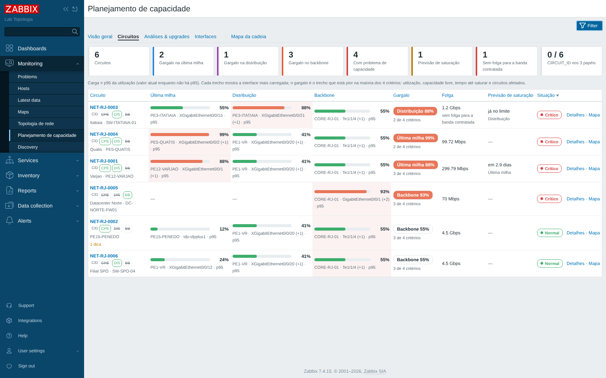
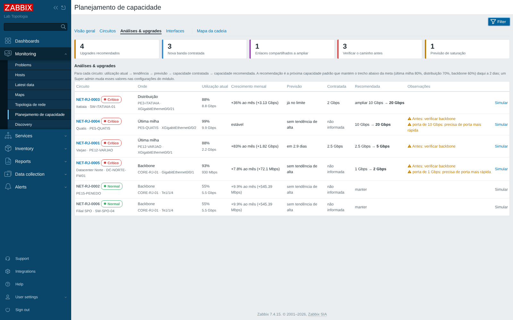

# Capacity planning por circuito

## A ideia, sem complicação

Pense num circuito como o encanamento que leva água da adutora até a casa do cliente:

- **Backbone (core)** é a adutora: o cano grosso que atende a cidade inteira.
- **Distribuição (agregação/metro)** é o cano do bairro.
- **Última milha (acesso/CPE)** é o cano que entra na casa do cliente.

A água que chega na casa é limitada pelo **cano mais apertado** do caminho. Capacity planning é descobrir
**qual cano está mais apertado** (o gargalo) e **quando ele vai ficar pequeno demais** (a previsão).

O problema é que cada cano é um equipamento diferente no Zabbix: o core é um host, a distribuição é
outro, o CPE é outro. Para o Zabbix saber que esses três pedaços são **o mesmo circuito**, cada ponto
recebe uma "etiqueta" com o mesmo nome: o **CIRCUIT_ID**.

## As premissas do projeto e onde cada uma é respondida

| Premissa | Resposta no Zabbix |
|---|---|
| Qual interface do backbone pertence ao mesmo circuito? | A que tem o CIRCUIT_ID (porta/subinterface do cliente no core). Sem porta própria, o caminho segue pelo LLDP/CDP: a **interface LAN do core** (a outra ponta do uplink do POP) e os **troncos do core**. |
| Qual porta de distribuição está no mesmo caminho? | A que tem o CIRCUIT_ID. Se esqueceram de marcar, o módulo encontra pelo LLDP/CDP (a porta na outra ponta do CPE) e avisa em **O que conferir**. |
| Qual interface do CPE fecha esse circuito? | A porta WAN do CPE com o CIRCUIT_ID (na descrição ou pela macro `{$CIRCUIT_ID}` do host). |
| Onde está o gargalo real? | No trecho que está pior na **maioria dos 4 critérios**: maior utilização, menor capacidade livre, menor tempo até saturar e maior impacto na cadeia. Veja "Como o gargalo é escolhido". |
| A saturação está no core, na agregação ou na última milha? | **Monitoramento → Planejamento de capacidade**: coluna **Gargalo** na lista e a tabela **Trecho a trecho** no detalhe, que compara os três grupos de interfaces do mesmo circuito. |
| O que vai saturar e o que devo fazer? | Aba **Análises & upgrades**: crescimento mensal, previsão e a **capacidade recomendada** de cada circuito (ex.: 1 Gbps → 2 Gbps), com o aviso do que conferir antes. No detalhe, a **simulação de upgrade** mostra o efeito em cada trecho. |

## As 3 camadas

### Camada 1 — template base: `Template Capacity Planning`

Lê a descrição de todas as interfaces (SNMP, IF-MIB) e cria itens só para as que têm um CIRCUIT_ID ou
uma palavra de enlace compartilhado. Para cada uma:

| Item | O que é |
|---|---|
| tráfego de entrada / saída | bits por segundo (contadores de 64 bits) |
| velocidade da porta | `ifHighSpeed`: a **capacidade nominal** |
| capacidade | a **banda contratada** do circuito, se definida; senão, a velocidade da porta |
| utilização | o maior sentido (entrada ou saída) ÷ capacidade |
| utilização p95 | percentil 95 de 7 dias: o "pico normal", sem os picos raros |
| pico em 24h | maior utilização do dia |
| utilização média | média de `{$CAPACITY.AVG.PERIOD}` (30 dias): o uso típico, para comparar com o atual e o p95 |
| crescimento do p95 em 30 dias | quanto o p95 sobe em um mês, em pontos percentuais, pela reta de tendência: base do **crescimento mensal** e da **capacidade recomendada** |
| p95 previsto | onde o p95 estará daqui a 30 dias, pela tendência de 30 dias |
| dias até o limite crítico | quanto falta para o p95 chegar ao limite crítico do papel |
| status operacional | up/down da porta |

Problemas criados (com as tags `circuit`, `segment`, `interface` e `component=capacity`):

- **High**: p95 acima do limite crítico;
- **Warning**: p95 acima do limite de atenção;
- **Information**: o p95 deve chegar ao limite crítico em menos de 60 dias.

Como os problemas têm a tag `interface`, o **mapa de topologia** pinta o link da cor do problema sozinho.
Cada problema também traz um **link para o módulo** (URL do trigger, "Planejamento de capacidade: NET-TO-0001"
no menu do problema): numa interface de um circuito ele abre o circuito; num enlace compartilhado, a lista
de circuitos que dependem dele. É o começo do fluxo **alerta → circuito → cadeia → gargalo → previsão →
upgrade**.

### Camada 2 — perfis por papel

| Template | Papel | Atenção | Crítico |
|---|---|---|---|
| `Template Capacity Planning - Backbone` | roteadores core, enlaces troncais | 60% | 80% |
| `Template Capacity Planning - Distribuicao` | agregação, metro, distribuição regional | 70% | 85% |
| `Template Capacity Planning - CPE` | CPE do cliente, última milha | 80% | 95% |

Cada perfil já inclui o template base. **Vincule só o perfil** ao equipamento. Os limites são padrões
razoáveis (o backbone precisa de folga para aguentar a queda de um tronco) e podem ser mudados no
perfil, no host ou por circuito.

### Camada 3 — correlação por circuito

| Mecanismo | Como foi usado |
|---|---|
| **Naming padrão** | `CID:<CIRCUIT_ID>` na descrição da interface; `UPLINK`/`TRONCO` nos enlaces compartilhados (ver abaixo). |
| **Macros** | `{$CIRCUIT_ID}` + `{$CIRCUIT_ID.IF}` no host (circuito do equipamento inteiro, para CPEs), banda contratada por circuito `{$CAPACITY.BW.MBPS:"NET-TO-0001"}=300`, limites por papel e por circuito (`{$CAPACITY.UTIL.CRIT:"NET-TO-0001"}=70`), janelas de p95 e de tendência. |
| **Tags** | Itens e problemas recebem `circuit`, `segment` (backbone/distribuicao/cpe), `link` (dedicado/compartilhado), `interface`, `capacity` (a métrica) e `cid_source` (de onde veio o CIRCUIT_ID: descricao, netbox ou macro); os itens também levam `alias` (a descrição da interface, de onde sai o cliente/site da tela). Dá para filtrar em Últimos dados e Problemas por `circuit` = `NET-TO-0001`. |
| **Inventário** | O campo **Tipo** do host é preenchido com Backbone, Distribuição ou CPE (inventário em modo automático). O script de enriquecimento também lê o CIRCUIT_ID de um campo do inventário. |
| **Dashboards por circuito** | Botão **Criar / atualizar dashboard** no detalhe do circuito: cria o dashboard público "Capacidade - NET-TO-0001" com um medidor por trecho, o gráfico do caminho e os problemas das interfaces do caminho (capacidade e link down). |

## Como identificar o mesmo circuito em vários hosts

O mesmo CIRCUIT_ID precisa chegar nos 3 papéis (backbone, distribuição e CPE). Há cinco jeitos, e eles
podem ser misturados. Pense neles como cinco portas de entrada que levam ao mesmo lugar: a tag `circuit`
de cada interface.

| Jeito | Onde se escreve | Quando usar |
|---|---|---|
| 1. **Convenção de nome** (recomendado) | descrição da interface: `CID:NET-TO-0001 Escola Centro` | Sempre que der: fica no equipamento, aparece no SNMP e em qualquer ferramenta. |
| 2. **Macro de host** | `{$CIRCUIT_ID}` = `NET-TO-0001` e `{$CIRCUIT_ID.IF}` = `ether1` | CPE onde não dá para mexer na descrição. O circuito vale para as interfaces listadas em `{$CIRCUIT_ID.IF}` (nomes separados por vírgula, `*` vale qualquer coisa: `sfp-sfpplus*`). |
| 3. **Base externa / CMDB (NetBox)** | campo personalizado `circuit_id` da interface no NetBox | Se o NetBox já é a fonte da verdade. Preencha `{$CAPACITY.NETBOX.URL}` e `{$CAPACITY.NETBOX.TOKEN}`. |
| 4. **Inventário, tag de host ou nome do host** | campo do inventário (ex.: Contract number), tag `circuit` ou um padrão no nome (`CPE-NET-TO-0001`) | Com o script `tools/capacity_enrich.py`, que copia o valor para a macro `{$CIRCUIT_ID}` (jeito 2). |
| 5. **Planilha / exportação do CMDB** | CSV `circuit_id;host;interface;contracted_mbps` | Com o mesmo script: grava as macros dos hosts e a banda contratada de cada circuito de uma vez. |

A ordem de preferência na descoberta é: descrição da interface → NetBox → macro do host. Na tela do
circuito, a coluna **CIRCUIT_ID vem de** mostra a origem de cada interface, e a linha **CIRCUIT_ID nos 3
papéis** mostra se o mesmo ID está escrito no CPE, na distribuição e no backbone (✓/✗). O módulo não
depende de os três estarem marcados — ele completa o caminho pelo LLDP/CDP —, mas o cartão
"CIRCUIT_ID nos 3 papéis" na lista mostra o quanto a rede já segue o padrão.

### O padrão de nomes (jeito 1, o que a equipe de rede faz)

**Formato do CIRCUIT_ID** — sugestão: `NET-<UF>-<NNNN>`, por exemplo `NET-TO-0001`.
Use letras, números e hífen, **sempre com 4 dígitos no final** (assim um filtro por `NET-TO-001`
não pega `NET-TO-0010` sem querer).

**Onde escrever** — na descrição da interface, em qualquer posição: `CID:NET-TO-0001 Escola Centro`.
Também valem `CID=...` e `cid: ...`. Uma interface com dois circuitos: `CID:NET-TO-0001,NET-TO-0002`.

| Ponto do caminho | Interface | Descrição de exemplo |
|---|---|---|
| CPE | porta WAN (a que vai para o POP) | `CID:NET-TO-0001 WAN` |
| POP (distribuição) | porta que **desce** para o cliente | `CID:NET-TO-0001 Escola Centro` |
| POP (distribuição) | porta que **sobe** para o core: o uplink do POP | `UPLINK CORE-TO-01` |
| Agregação regional | porta que sobe para o core | `UPLINK CORE-TO-01` |
| Core | subinterface/VLAN/porta do cliente (se existir) | `CID:NET-TO-0001 Escola Centro` |
| Core | porta que desce para o POP: a interface LAN do core | `TRUNK POP-CENTRO` |
| Core | troncos para o resto do backbone | `TRONCO BB-BSB-01` |

Os uplinks e troncos **não precisam listar os circuitos**: o módulo sabe quais circuitos passam por eles
pelo LLDP/CDP. As palavras aceitas são configuráveis em `{$CAPACITY.SHARED.WORDS}`
(padrão `UPLINK,TRONCO,TRUNK`).

```text
Huawei VRP       interface XGigabitEthernet0/0/9
                  description CID:NET-TO-0001 Escola-Centro
Cisco IOS/IOS-XE interface TenGigabitEthernet0/0/1
                  description CID:NET-TO-0001 Escola-Centro
Juniper          set interfaces xe-0/0/1 description "CID:NET-TO-0001 Escola-Centro"
```

No MikroTik e em outros fabricantes, confira se o texto aparece no SNMP antes de padronizar:

```bash
snmpwalk -v2c -c COMUNIDADE IP_DO_EQUIPAMENTO 1.3.6.1.2.1.31.1.1.1.18
```

Descrições com acento funcionam (chegam como Hex-STRING e o template converte).

## Os pontos do caminho

A estrutura lógica do fluxo é **CORE (interface LAN) ← UPLINK ← POP ← CLIENTE**. O detalhe do circuito
mostra exatamente essa sequência, com os nomes reais:

```text
CLIENTE          POP                     UPLINK DO POP           AGREGAÇÃO REGIONAL     CORE (INTERFACE LAN)   TRONCOS DO CORE
CPE WAN    →     porta do POP para  →    porta do POP que   →    (se houver) uplink →   outra ponta do    →    saídas do core para
                 o cliente               sobe para o core        da agregação           uplink, no core        o resto do backbone
```

| Trecho (segmento) | Pontos que entram |
|---|---|
| **Última milha** | WAN do CPE, porta do POP para o cliente (e porta do core para o cliente, quando o cliente liga direto no core) |
| **Distribuição** | uplink do POP, uplinks da agregação regional (POPs em cadeia ou anel) e a interface LAN do core na outra ponta |
| **Backbone** | troncos do core |

Se um ponto existe no LLDP/CDP mas a porta não é medida (sem CID nem palavra de enlace compartilhado),
ele aparece no caminho como "não monitorado" — e a dica em **O que conferir** diz o que escrever na porta.

## Como o gargalo é escolhido (os 4 critérios)

Para cada trecho o módulo calcula quatro números (sempre do "cano mais apertado" do trecho):

| Critério | O que mede | Pior é |
|---|---|---|
| **Utilização relativa** | p95 da utilização (o valor atual enquanto não há p95) | a maior |
| **Capacidade livre** | capacidade × (1 − utilização), em bits/s | a menor |
| **Tempo até saturar** | dias até o p95 chegar ao limite crítico, pela tendência | o menor |
| **Impacto na cadeia** | quantos circuitos passam pelo mesmo trecho | o maior |

Cada critério dá um "voto" para o trecho pior nele. **O gargalo é o trecho com mais votos.** Um critério
em que todos os trechos empatam não vota. Em empate de votos, vale a maior utilização; depois, o trecho
mais perto do cliente.

Na tabela **Trecho a trecho** do detalhe do circuito, cada critério aparece marcado com **pior** no
trecho que ganhou o voto, e a frase do topo diz "Escolhido por 2 de 4 critérios: maior utilização, menor
capacidade livre". Assim dá para ver na hora quando os critérios discordam (por exemplo: a distribuição
está mais cheia hoje, mas a última milha vai saturar primeiro).

## Visão por circuito, trecho a trecho

Para cada trecho (última milha, distribuição, backbone) o detalhe do circuito compara:

| Medida | De onde vem |
|---|---|
| Capacidade nominal | velocidade da porta (`ifHighSpeed`) |
| Capacidade usada no cálculo | banda contratada do circuito ou, sem ela, a nominal |
| Utilização atual | último valor, em % e em bits/s |
| 95º percentil | p95 de `{$CAPACITY.P95.PERIOD}` (7 dias), em % e em bits/s |
| Média (30 dias) | média de `{$CAPACITY.AVG.PERIOD}` |
| Crescimento mensal (p95) | quanto o p95 sobe por mês, em % do p95 de hoje e em bits/s |
| Capacidade livre | quanto ainda cabe |
| Tempo até saturar | dias até o limite crítico |
| Circuitos no mesmo trecho | o impacto: quantos circuitos dependem dele |
| Comporta a banda contratada | ver abaixo |
| Estado | OK / Atenção / Crítico (pelos problemas de capacidade) / Down |

### Banda contratada × capacidade nominal

A **banda contratada** é do circuito: `{$CAPACITY.BW.MBPS:"NET-TO-0001"}` = `300` (Mbps), como macro
global ou no host do CPE. A **capacidade nominal** é de cada porta (`ifHighSpeed`).

Com a banda contratada definida, o módulo responde "cada trecho comporta o contratado?":

- numa porta **dedicada** ao circuito: a porta precisa ser pelo menos tão rápida quanto o contratado
  (uma porta de 100M para um contrato de 500M aparece como "não");
- num enlace **compartilhado** (uplink, tronco): a **folga** precisa caber o contratado — se o cliente
  usar tudo o que comprou, o uplink aguenta?

O cartão **Sem folga para a banda contratada** na lista conta os circuitos com algum trecho que não comporta.

## Visão geral, análises e upgrades

A página **Planejamento de capacidade** tem quatro abas, uma para cada pergunta da equipe:

| Aba | Pergunta |
|---|---|
| **Visão geral** | Onde devo prestar atenção agora? |
| **Circuitos** | Como está cada cliente? |
| **Mapa da cadeia** (abre o mapa de topologia) | Onde está o gargalo? |
| **Análises & upgrades** | O que vai saturar e o que devo fazer? |

E o caminho de trabalho é sempre o mesmo: **alerta → circuito → cadeia → gargalo → previsão → upgrade
recomendado**.

### Visão geral

No topo, seis números: **circuitos monitorados**, **utilização média** (do gargalo de cada circuito),
**circuitos acima de 80%**, **alertas críticos** (problemas de capacidade High ou pior), **previsão de
saturação** e **capacidade livre da cadeia** (a folga somada de todas as interfaces dos caminhos, cada uma
uma vez só).

Logo abaixo, a **situação** de cada circuito, como um semáforo:

| Situação | Quando |
|---|---|
| **Crítico** | enlace caído, problema crítico do papel, 90% ou mais, ou satura em até 30 dias |
| **Alto** | problema de atenção do papel, 80% ou mais, ou satura em até 60 dias |
| **Médio** | 60% ou mais |
| **Normal** | abaixo de 60% |

O **ranking dos circuitos** vem ordenado pelo risco (enlace caído primeiro, depois o maior entre a
utilização e a proximidade da saturação), com cliente/site, utilização, **média de 30 dias**, previsão e
situação — o implantador começa pelo que realmente exige intervenção. Por último, os **upgrades
recomendados** mais urgentes.

O **cliente/site** sai da descrição da porta do POP para o cliente (`CID:NET-TO-0001 Escola Centro` →
"Escola Centro") e do nome do CPE (ou do vizinho LLDP/CDP, quando o CPE não é monitorado).

### Análises & upgrades: a capacidade recomendada

Para cada circuito a aba mostra a sequência **utilização atual → tendência → previsão → capacidade
contratada → capacidade recomendada**.

Pense num cano que hoje passa 980 Mbps e cresce 70 Mbps por mês. A conta é:

1. **Quanto vai passar** no fim do horizonte de planejamento (padrão: 180 dias), pela tendência:
   980 + 6 × 70 = 1.400 Mbps.
2. **Quanto cano precisa** para isso ficar abaixo da **meta** do trecho (padrão: última milha 80%,
   distribuição 70%, backbone 60% — os limites de atenção dos perfis): 1.400 ÷ 0,8 = 1.750 Mbps.
3. **O próximo tamanho padrão** acima disso e acima do atual: **2 Gbps** (a lista vai de 10 Mbps a 800 Gbps:
   …, 500M, 1G, 2G, 2,5G, 5G, 10G, 20G, 25G, 40G, 50G, 100G…).

Se o trecho que precisa crescer é do próprio circuito (última milha, porta do cliente no core), a
recomendação é uma **nova banda contratada** ("1 Gbps → 2 Gbps"); se é um enlace compartilhado, é
**ampliar o enlace** ("ampliar 10 Gbps → 20 Gbps"), com quantos circuitos usam esse enlace.

Avisos que aparecem junto:

- **⚠ Antes: verificar …** — com o cliente usando toda a banda nova, algum enlace compartilhado do caminho
  ficaria acima da meta. É o "verifique a capacidade do POP antes do upgrade": evita recomendar a última
  milha quando o próximo gargalo está na agregação.
- **⚠ porta de 1 Gbps** — a nova banda é maior que a velocidade da porta física: precisa de porta (ou
  interface) mais rápida.

As metas e o horizonte ficam em **Configurações do módulo → Planejamento de capacidade** (Super admin).

### Simulação de upgrade

No detalhe do circuito, **Simulação de upgrade** responde "se eu fizer upgrade de 1G para 2G, o que acontece
em cada trecho?". Escolha a capacidade (vem marcada a recomendada) e a tabela mostra, para cada trecho,
**hoje → depois**: capacidade, uso (p95), folga e situação. Não tem botão: ao trocar o valor (com o mouse ou
com as setas do teclado), só a tabela da simulação é recalculada. A página não recarrega nem volta para o
topo, e o endereço guarda o valor simulado (F5 ou um link copiado abrem a mesma simulação).

É o **pior caso**: as portas do circuito ganham a capacidade nova, e os enlaces compartilhados do caminho
recebem a diferença entre a capacidade nova e o tráfego de hoje do circuito (como se o cliente passasse a
usar tudo o que comprou). A frase do fim diz se todos os trechos comportam ou qual planejar primeiro.

### Mapa da cadeia

A aba **Mapa da cadeia** abre o mapa de topologia com os links coloridos pela utilização (p95) medida pelo
capacity planning — um mapa lógico da capacidade, não um mapa geográfico:

| Cor | Utilização |
|---|---|
| verde | abaixo de 60% |
| amarelo | 60% a 80% |
| laranja | 80% a 90% |
| vermelho | 90% ou mais |
| cinza | link não medido pelo capacity planning |

Cada link mostra a utilização e quantos circuitos dependem dele; clicando no link aparece a lista dos
circuitos (cada um abre o seu detalhe). O botão de medidor na barra da esquerda do mapa liga e desliga
esse modo em qualquer mapa salvo; o link **Mapa** de cada circuito abre o mapa da cadeia com o caminho
do circuito aceso.

## Automatizar o enriquecimento

| Como | O que faz |
|---|---|
| **LLD** (descoberta) | lê as descrições a cada `{$CAPACITY.LLD.INTERVAL}` e cria/remove os itens das interfaces sozinho |
| **API do Zabbix** | `tools/capacity_enrich.py` grava `{$CIRCUIT_ID}`, `{$CIRCUIT_ID.IF}` e a banda contratada a partir de CSV, inventário, tag ou nome do host |
| **Inventário** | o template preenche o campo Tipo (papel); o script lê o CIRCUIT_ID de qualquer campo do inventário |
| **Base externa / CMDB** | NetBox direto na descoberta (`{$CAPACITY.NETBOX.URL}`), ou uma exportação CSV de qualquer CMDB pelo script |

Exemplos do script (sem `--apply` ele só mostra o que mudaria):

```bash
cd tools
# Planilha do CMDB: circuit_id;host;interface;contracted_mbps
python3 capacity_enrich.py --url https://zabbix.exemplo --token SEU_TOKEN --csv circuitos.csv
python3 capacity_enrich.py --url https://zabbix.exemplo --token SEU_TOKEN --csv circuitos.csv --apply --discover

# CIRCUIT_ID no campo "Contract number" do inventário dos CPEs, WAN = ether1
python3 capacity_enrich.py --url https://zabbix.exemplo --token SEU_TOKEN --group CPEs \
    --inventory contract_number --interface ether1 --apply

# CIRCUIT_ID no nome do host (CPE-NET-TO-0001)
python3 capacity_enrich.py --url https://zabbix.exemplo --token SEU_TOKEN --group CPEs \
    --name-regex 'CPE-(?P<cid>NET-[A-Z]{2}-[0-9]{4})' --interface ether1 --apply
```

O token vem de *Usuários → Tokens de API*. Para gravar a banda contratada (macro global), o usuário
precisa ser Super admin; as macros de host pedem permissão de escrita nos hosts.

## Fluxo de dados: Zabbix > ingestão > inteligência

```text
   COLETA                 ENRIQUECIMENTO             CORRELAÇÃO                  VISUALIZAÇÃO
 ┌────────────┐        ┌──────────────────┐       ┌───────────────────┐       ┌──────────────────────┐
 │ SNMP       │        │ descrição (CID)  │       │ mesmo CIRCUIT_ID  │       │ visão geral, ranking │
 │ IF-MIB     │──LLD──▶│ macro de host    │──────▶│ + LLDP/CDP        │──────▶│ trecho a trecho      │
 │ LLDP / CDP │        │ NetBox / CMDB    │ tags  │ = caminho cliente │       │ upgrades, simulação  │
 │ tráfego    │        │ inventário (API) │       │   → POP → core    │       │ mapa da cadeia       │
 └────────────┘        └──────────────────┘       │ 4 critérios       │       │ dashboard, problemas │
   templates              template + script        └───────────────────┘       └──────────────────────┘
                                                      módulo do frontend
```

1. **Coleta** — os templates leem tráfego, velocidade, status e vizinhos (LLDP/CDP) por SNMP.
2. **Enriquecimento** — a descoberta põe o CIRCUIT_ID, o papel e o tipo de enlace em tags; o script
   preenche o que vem de fora (CMDB, inventário).
3. **Correlação** — o módulo junta as interfaces do mesmo circuito, completa o caminho pelo LLDP/CDP,
   escolhe o gargalo pelos 4 critérios e calcula a capacidade recomendada.
4. **Visualização** — visão geral, circuitos, análises & upgrades, mapa da cadeia, dashboard nativo e os
   problemas do Zabbix (que já podem disparar ações e alertas, e têm o link para o circuito).

## As telas


- **Monitoramento → Planejamento de capacidade**
  - **Visão geral**: os seis números, a situação dos circuitos, o ranking por risco e os upgrades mais
    urgentes.
  - **Circuitos**: um por linha, com a carga de cada trecho, o gargalo (e quantos critérios ele ganhou),
    a folga, a previsão e a situação. Ao lado do ID, `CID CPE DIS BB` mostra em quais papéis o ID está
    escrito. Filtros: grupos, hosts, parte do CID, "só os que precisam de atenção".
  - **Análises & upgrades**: crescimento mensal, previsão, contratada e recomendada de cada circuito.
  - **Interfaces**: todas as interfaces medidas, da mais carregada para a menos, com os circuitos que
    dependem de cada uma (bom para ver qual tronco atende mais clientes).
  - **Mapa da cadeia**: o mapa de topologia colorido pela utilização.





- **Detalhe do circuito** (clique no CID): situação, cliente/site, banda contratada, CIRCUIT_ID nos 3 papéis,
  o caminho CLIENTE → POP → UPLINK → CORE, os cartões por trecho, **O que conferir**, a tabela **Trecho a
  trecho**, **Análise e upgrade**, **Simulação de upgrade**, o gráfico de todas as interfaces e a tabela
  completa.


- **Ver no mapa**: abre o mapa da cadeia com o caminho do circuito aceso e o resto apagado.


- **Criar / atualizar dashboard**: cria o dashboard "Capacidade - NET-TO-0001" (público), ou atualiza se
  já existir. Se outra pessoa criou e você não pode editar, ele só é aberto.

## Implantar na rede de verdade

1. Importe `templates/capacity_planning.yaml` e atualize o módulo (versão 1.3.0 ou mais nova). Os itens
   novos (média de 30 dias, crescimento) e o link dos problemas chegam às interfaces já descobertas em até
   1 hora.
2. Vincule os perfis por papel: um grupo de hosts por papel facilita (ex.: "Regional Norte/Core").
3. (Opcional) Deixe o inventário dos hosts em **Automático** para preencher o campo Tipo.
4. Combine o padrão de nomes com a equipe de rede e comece por um piloto pequeno (alguns circuitos de uma
   região). Em até 1 hora (`{$CAPACITY.LLD.INTERVAL}`) as interfaces aparecem.
5. Banda contratada: macros globais `{$CAPACITY.BW.MBPS:"NET-TO-0001"}` = `300` (Mbps) — à mão ou pelo
   script com a coluna `contracted_mbps`.
6. CPEs sem CID na descrição: `{$CIRCUIT_ID}` e `{$CIRCUIT_ID.IF}` no host (ou o script).
7. Ajuste os limites dos perfis se precisar.
8. NetBox (opcional): preencha `{$CAPACITY.NETBOX.URL}` e `{$CAPACITY.NETBOX.TOKEN}` (macro secreta).
   Interfaces sem CID na descrição passam a buscar o CID no campo personalizado
   `{$CAPACITY.NETBOX.FIELD}` (padrão `circuit_id`) da interface no NetBox, ou na descrição dela lá.
   O nome do equipamento no NetBox é o sysName (ou `{$CAPACITY.NETBOX.DEVICE}`).

O p95 precisa de alguns dias de dados para valer de verdade (a janela é de 7 dias), e a previsão fica
confiável depois de algumas semanas (a tendência usa 30 dias). Uma mudança brusca (banda contratada nova,
tráfego mudado de porta) faz a tendência parecer muito alta por alguns dias — e a capacidade recomendada
junto: confira o crescimento mensal antes de pedir um upgrade.

## Limites conhecidos

- O Zabbix não sabe por qual tronco do core o tráfego de um cliente sai (isso é roteamento). Por isso o
  trecho backbone considera todos os troncos do core e mostra o mais carregado.
- Subinterfaces e VLANs costumam informar velocidade 0: defina a banda contratada do circuito (ou, num
  enlace compartilhado, `{$CAPACITY.BW.MBPS:"<nome da interface>"}` no host).
- A mesma porta física medida nas duas pontas (CPE e distribuição) usa os limites de cada papel. Para
  alinhar, use limite por circuito: `{$CAPACITY.UTIL.CRIT:"NET-TO-0001"}`.
- `{$CIRCUIT_ID.IF}` usa nomes de interface, não expressões regulares (o Zabbix cola o valor da macro
  dentro do script de descoberta, e barras invertidas se perderiam).
- Em redes muito grandes, filtre a tela por grupo: ela lê o último valor de cada item exibido.
- A capacidade recomendada é uma conta simples: tendência em linha reta e a lista de tamanhos padrão. Ela
  aponta o que olhar e quanto pedir; a decisão (prazo de entrega, custo, troca de equipamento) continua
  com a equipe.
- A simulação é o pior caso (o cliente usando toda a banda nova ao mesmo tempo que o resto da rede no p95);
  na prática a folga costuma ser maior.
- O mapa da cadeia refaz a conta de capacidade da rede toda a cada atualização do mapa. Em redes muito
  grandes, deixe o modo ligado só quando for usar, ou aumente o intervalo de atualização do usuário.
